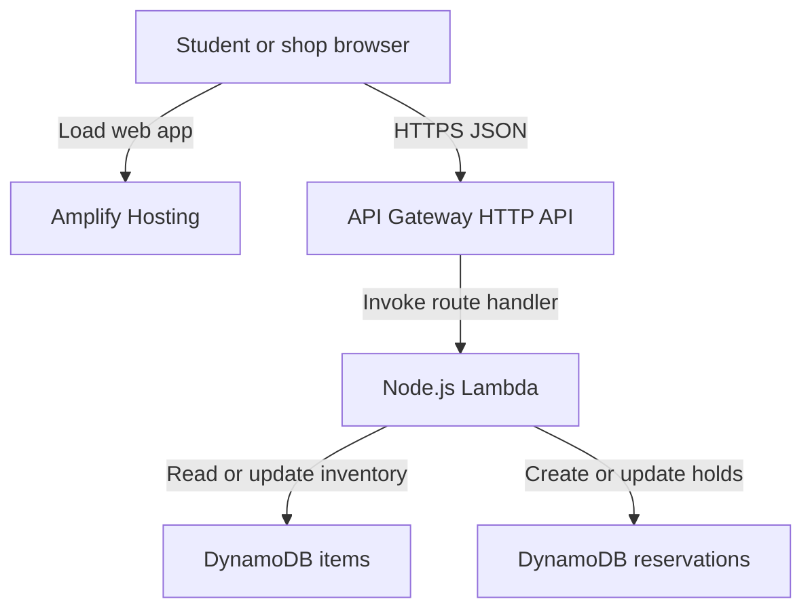

# Astrashop AWS build summary

**Deployment.** [LIVE PROTOTYPE URL] in [AWS REGION], using [RELEASE COMMIT]. Fill in these details from the deployed build before submission.

## Request flow

1. The browser loads the static React app from Amplify Hosting. The Vite build uses `VITE_API_URL` to locate the HTTP API. `GET /items` reads the catalog, stock counts, latest confirmation times, and pickup windows.
2. For a hold, the browser generates a reservation UUID and sends it with the item ID. Lambda issues one DynamoDB transaction. It subtracts one unit only if stock is at least one and creates a `HELD` reservation only if the ID is unused. Both writes commit together. A retry sends the same UUID, so it cannot deduct another unit through the same reservation ID.
3. The browser checks status by reservation ID. The shop counter sends its key in `x-shop-key` to list holds, confirm a stock count, or collect or release a hold. API Gateway handles browser CORS. Lambda checks the key and allows collect and release only from `HELD`. Release returns one unit in the same transaction that closes the hold. A stock recount carries the count the shopkeeper started from and is rejected if a reservation or release changed stock in the meantime, so a unit already set aside is never offered again. Transient DynamoDB conflicts and throttling return `503`, which the app retries with the same reservation ID.

## What each service does

| AWS service | Feature and data | Why it fits | Cost, security, or reliability |
| --- | --- | --- | --- |
| **Amplify Hosting** | Serves the compiled HTML, JavaScript, and CSS. | Publishes a mobile web app over HTTPS from a static build. | Only the API URL is public frontend configuration. Keep the served build available through Demo Day and check hosting usage in AWS Billing. |
| **API Gateway HTTP API** | Receives catalog, reservation, and shop requests and passes them to Lambda. | Gives the browser a single HTTPS API endpoint with method and path routing. | CORS allows the declared methods and `x-shop-key`. The key is checked in Lambda. Monitor request volume and test preflight from the deployed origin. |
| **AWS Lambda** | Handles JSON validation, stock updates, and reservation state changes. | One handler is enough for the small set of MVP routes without running a server continuously. | The runtime gets the shop key from configuration. The execution role scopes DynamoDB access to the app tables. Check invocation errors and timeout behavior during the live test. |
| **Amazon DynamoDB** | Stores item details, shelf stock and confirmation timestamps, and UUID-keyed holds with codes and status. | Conditional transactions protect the subtract-and-create and release-and-restock operations. | The template uses on-demand capacity. Check storage and request usage, and distinguish concurrent-write failures from out-of-stock responses during verification. |

## Deployment and verification

The AWS SAM template provisions the API, Lambda, execution role, and tables. Build the frontend against the API output URL and deploy the static build to Amplify Hosting. If seeding sample items, keep the **Sample data** label visible. Record the budget alert, Free Tier eligibility for the deployed resources, and the test date in [DEPLOYMENT NOTES].

Record actual results for [SIGNED-OUT HTTPS TEST], [LAST-UNIT AND SAME-ID RETRY TEST], [SHOP PREFLIGHT AND KEY TEST], and [COLLECT AND RELEASE TEST]. Update the service list and request flow to match the release commit before handoff.
