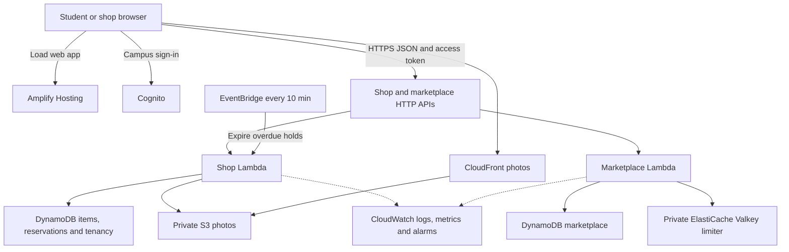

# Astrashop AWS build summary

**Deployment.** [Live Astrashop pilot](https://main.d122punxfnd0ue.amplifyapp.com/) in `ap-southeast-2` (Sydney), using release `181c9ad5eb9cce7c5fa9edb4e4974d294f4929e1`. The catalog contains labeled sample stock. See the [deployment record](../production/DEPLOYMENT.md) for verified checks and remaining account tests.

## Request flow

1. The browser loads the static React app from Amplify. The public shop API reads the catalog, stock counts, confirmation times, and pickup windows from DynamoDB. The pilot has 12 labeled sample items.
2. Students sign in through Cognito before reserving. Self-signup accepts the `adypu.edu.in` email domain. For each hold, the browser sends a UUID and item ID. One DynamoDB transaction reduces stock, creates the hold, and enforces the limit of three active holds per student per shop. A retry with the same UUID returns the existing hold.
3. Staff sign in through the same pool. The shop Lambda checks their shop role before it changes inventory or pickups. A stock recount includes the expected version, so a concurrent reservation causes the recount to fail safely. Collect, release, and expiry close a hold once. Staff actions create audit records. The legacy shared counter key is disabled on this deployment.
4. EventBridge runs hold expiry every 10 minutes. The shop Lambda marks overdue holds `EXPIRED` and returns stock in a transaction. The counter lists physical returns until staff confirm that each item is back on the shelf.
5. The marketplace Lambda serves student listings, profiles, saved offers, messages, reviews, and moderation routes. DynamoDB stores the records. A private Valkey cache applies per-user and per-network request limits. Failed limiter checks refuse writes. The initial marketplace has no listings.

## What each service does

| AWS service | Feature and data | Why it fits | Cost, security, or reliability |
| --- | --- | --- | --- |
| **Amplify Hosting** | Serves the compiled frontend over HTTPS. | No application server is needed for static files. | CSP, HSTS, `nosniff`, and frame restrictions are configured. Public settings contain API origins and Cognito client details. |
| **API Gateway HTTP APIs** | Route shop and marketplace requests to their Lambda functions. | Provides HTTPS endpoints and Cognito token checks. | CORS allows only the live frontend. Shop throttles target 200 requests/s with a burst of 400. Marketplace throttles target 35 requests/s with a burst of 70. These are best-effort limits. |
| **AWS Lambda** | Runs shop, marketplace, and signup validation code on Node.js 22. | Handles requests without a continuously running app server. | Execution roles restrict data access to the required tables, indexes, and photo prefix. Logs are retained for 30 days. |
| **Amazon DynamoDB** | Stores all application records in four tables. | Conditional transactions protect inventory, hold limits, and state changes. | On-demand capacity, point-in-time recovery, and retained tables protect the data. |
| **Amazon Cognito** | Provides campus accounts and role groups. | Both APIs use the same user pool. | OAuth authorization code flow uses PKCE. Shop roles are checked against current tenancy records. |
| **ElastiCache and Secrets Manager** | Run the private Valkey limiter and store its password. | Reuses the Redis token-bucket implementation. | TLS, private subnets, and a restricted cache user protect access. Valkey reduces the minimum storage charge. |
| **S3 and CloudFront** | Store and serve item photos. | Keeps image storage separate from the API. | S3 is private. CloudFront uses origin access control. The API validates image contents and size. |
| **EventBridge and CloudWatch** | Schedule expiry and record logs, metrics, and alarms. | Provides operations support without a separate worker server. | Alarms cover server errors, expiry heartbeat, hold-count mismatches, billing signatures, and limiter failures. Email alerts are not configured. |

## Deployment and verification

Two SAM stacks provision the backend and share the Cognito pool. The deployment script builds and uploads the frontend to Amplify. Both stacks reached `CREATE_COMPLETE`, and Amplify job `1` succeeded on 28 November 2026. The AWS account permits Sydney and refused the attempted Mumbai region.

The backend passed 89 tests, with three local-service tests skipped. All eight client tests and both production frontend builds passed. Both SAM templates passed lint validation. Ten live checks passed for public reads, private-route rejection, CORS, and frontend security headers. A browser loaded the catalog, item page, marketplace, and Cognito sign-in. A manual expiry sweep returned successfully.

The expiry heartbeat also appeared in CloudWatch. The initial platform administrator account was created and invited by email. Its first sign-in and password setup are pending. An authenticated reservation and staff workflow still need a real campus account. No shop owner has been assigned. Phone photo upload and Razorpay events remain unverified. The billing webhook is disabled until a secret is configured. AWS credits cover eligible usage while available; inspect actual service costs in AWS Billing. The linked email listed 27 November 2026 as the challenge deadline, before this deployment.
